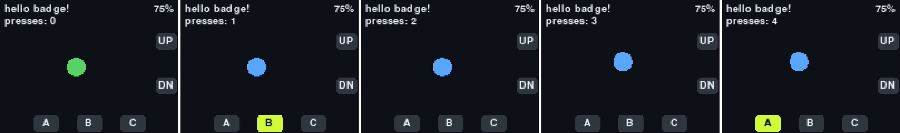

# Universe 2025 (Tufty) Badge で遊ぶ

GitHub Universe 2025 でもらったバッジ（Pimoroni Tufty 2350 ベース、MonaOS + MicroPython）用の自作アプリと、開発用の道具を置いているリポジトリです。

公式リポジトリ [badger/home](https://github.com/badger/home) は 2026 年版のバッジ向けに変わっています。2025 年版の資料・シミュレーター・標準アプリは、その中の `badge25/` にあります。

## アプリ

### hello_badge

ボタンテスターです。押したボタンの枠が、実機と同じ位置（右端に UP / DOWN、下端に A / B / C）で光ります。

- A / C / UP / DOWN: 丸を動かす
- B: 丸の色を変える
- 右上: 電池残量



## フォルダ構成

| パス | 中身 |
|---|---|
| `system/` | バッジの `/system` と同じ構成。自作アプリ（`system/apps/<名前>/`）だけを Git で管理する |
| `tools/bootstrap.py` | 公式リポジトリを `vendor/home` に取得し、標準アプリとフォントを `system/` にコピーする |
| `tools/sim_snapshot.py` | シミュレーターを画面なしで動かし、ボタン操作を自動で入れて画面写真を保存する |
| `docs/images/` | README 用の画面写真 |

## 準備（Windows）

```powershell
python -m venv .venv
.venv\Scripts\python -m pip install pygame mpremote
.venv\Scripts\python tools\bootstrap.py
```

## シミュレーターで動かす

```powershell
.venv\Scripts\python vendor\home\badge25\simulator\badge_simulator.py -C system system\apps\hello_badge
```

キー操作: 矢印 = UP / DOWN、Z / X / Space = A / B / C、Esc = HOME。

画面写真を自動で撮る例（20 フレーム目に B を押し、10 と 30 フレーム目を保存）:

```powershell
.venv\Scripts\python tools\sim_snapshot.py system\apps\hello_badge out\hello_badge --keys "20:b" --shots 10,30
```

シミュレーターには LED バックライトがなく、電池残量は常に 75% です。

## バッジに入れる

1. USB-C（データ通信できるケーブル）で PC につなぐ
2. 背面の `RESET` をすばやく 2 回押す。画面に「USB Disk Mode」と出て、`BADGER` ドライブが現れる
3. `system/apps/<アプリ名>/` を、ドライブの `apps/` にフォルダごとコピーする
4. ドライブを取り外し、`RESET` を 1 回押して再起動する

工場出荷時のメニューは、6 個のアプリを決め打ちで並べる作りです。このバッジでは、アプリを自動で見つけてページ分けする `badge25/apps/menu` 版（`default_icon.png` も含む）に替えてあります。
